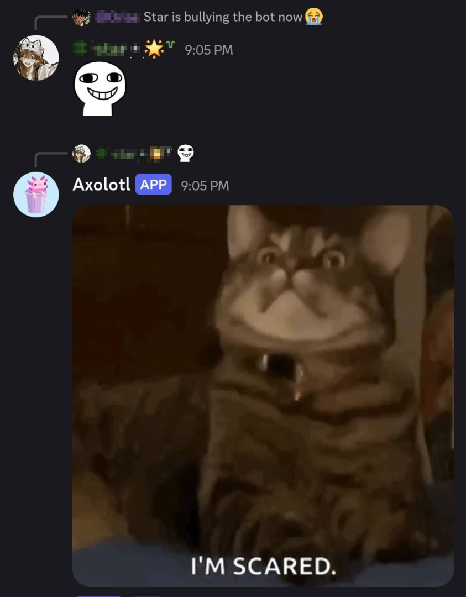

<div align="center">

<!--  -->


# DumbCord

**A Discord bot that learns from your server chats — and becomes you!**

No LLM. No API key. No filter. Everything stays on your machine, so the bot is as
unfiltered as your server is. A true mirror.

<sub>`@mention` it · DM it · or just talk in the configured channel — [detailed usage →](USAGE.md)</sub>


</div>

## How It Works

- A scraper script first downloads the server history to train the bot
- The actual bot is then run, which loads this message history and uses retrieval and Markov methods to reply to users with text and GIFs.

## Quickstart

```bash
# 1. Clone & set up environment
git clone https://github.com/Bittu5134/DumbCord.git && cd DumbCord
python -m venv .venv && source .venv/bin/activate
pip install -r requirements.txt

# 2. Configure credentials & target channels
cp .env.example .env          # paste your DISCORD_TOKEN
# adjust server & channel IDs in config.toml if needed

# 3. Scrape history & run
python scraper.py             # download messages (press Enter for max history)
python bot.py                 # start listening and replying
```

> **Note:** Requires **Python 3.11+** and **Message Content Intent** enabled in your [Discord Developer Portal](USAGE.md#discord-developer-portal-setup).

### Interacting with the Bot

- `@DumbCord <message>` anywhere in the server
- Direct message the bot
- Chat directly in the configured channel
- Use `!dumb_reload` after scraping new messages to retrain on the fly

### [Documentation →](USAGE.md)

<br>

## Built Using

[discord.py](https://github.com/Rapptz/discord.py) · [Markovify](https://github.com/jsvine/markovify)

<br>
